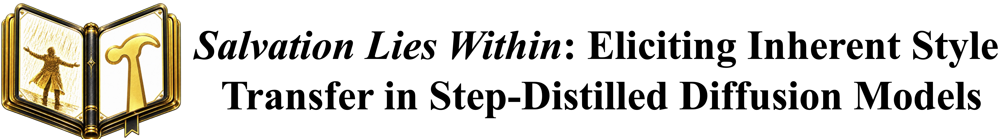
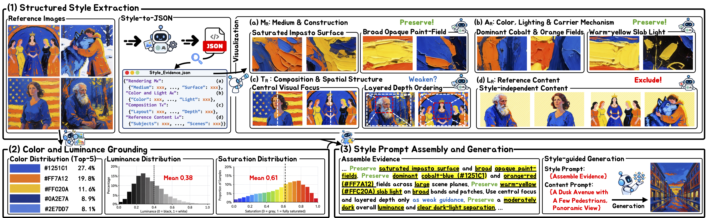

<div align="center">



<a href="https://arxiv.org/abs/2610.05066"></a>
<a href="https://pytorch.org/"></a>

</div>

<br/>


This is the Pytorch implementation for our paper: [**Salvation Lies Within: Eliciting Inherent Style Transfer in Step-Distilled Diffusion Models**](https://arxiv.org/abs/2610.05066). 

## Abstract
<div style="text-align: justify;">
  Adapting step-distilled text-to-image (T2I) models through post-training incurs additional computational costs and affects native few-step generation behavior. This motivates a complementary route beyond style-specific adaptation: drawing on the visual knowledge already encoded in step-distilled T2I models to elicit stylistic capabilities through language. Pursuing this direction requires textual guidance that captures how visual attributes jointly define a style and remain applicable as the depicted content changes. To explore this approach, we introduce StyleForge, a fully automatic, training-free framework that expresses reference styles as reusable rendering instructions. By integrating overall rendering characteristics with local color and lighting behavior, StyleForge organizes visual evidence from reference images into a coherent specification of how the target style should be expressed. The specification is then compiled into textual guidance that can be reused across content prompts, enabling frozen step-distilled T2I models to render different subjects and scenes in the reference style while retaining native few-step generation. Extensive experiments show relative gains of up to 29.47\% in generation quality scores over the strongest baseline, while Pareto analysis indicates that improved stylization is accompanied by strong adherence to the requested content.
</div>
<br>



## Requirements

The StyleForge generation pipeline uses Python 3.10 and the following key packages:

```shell
PyTorch==2.10.0
Transformers==5.10.1
Diffusers==0.38.0
Accelerate==1.14.0
NumPy==1.26.4
```

Evaluation uses a separate Python 3.10 environment with SGLang to run the
vision-language model judges. Its key packages are:

```shell
SGLang==0.5.10.post1
PyTorch==2.9.1
Transformers==5.3.0
Triton==3.5.1
NumPy==1.26.4
```

Both environments include CUDA 12.8 runtime packages. For complete package
versions, see the two environment snapshots in [code/requirements.txt](code/requirements.txt).
These snapshots are not a `pip install -r` requirements file.

## Code Structure

```text
StyleForge/
├── code/                           # Source, runtime data, and launchers
│   ├── configs/                    # Pipeline settings and content prompts
│   │   ├── default.json            # StyleForge backend and generation settings
│   │   ├── content_prompts.json    # Prompts shared across generation methods
│   │   └── run.env                 # Defaults for generation launchers
│   ├── data/styles/                # Bundled reference-style images and metadata
│   ├── models/                     # Placeholders for local FLUX, VLM, and CLIP weights
│   ├── styleforge/                 # Core StyleForge implementation
│   │   ├── vlm_client.py           # Reference-image VLM requests and responses
│   │   ├── style_schema.py         # Style schema and prompt compilation
│   │   └── flux2_generator.py      # Local FLUX.2-Klein generation backend
│   ├── scripts/                    # StyleForge workflow stages and runtime helpers
│   │   ├── extract_style.py        # Extract style contracts from references
│   │   ├── compile_style.py        # Compile contracts into reusable prompts
│   │   └── generate_method.py      # Generate images from compiled prompts
│   ├── training_free_baselines/    # DSE and RCG implementations
│   │   └── run_baselines.py
│   ├── training_based_baselines/   # Vanilla-SFT, PSO, and D-OPSD training code
│   │   ├── Vanilla-SFT/
│   │   ├── PSO/
│   │   ├── D-OPSD/
│   │   ├── generate_flux.py        # Generate images from trained LoRAs
│   │   └── checkpoints/            # Checkpoint placeholders; weights are not tracked
│   ├── evaluation/                 # Metrics and SGLang-based VLM judging
│   │   ├── metrics.py              # Aggregate the paper's evaluation metrics
│   │   ├── judge_service.sh        # Start and stop local SGLang judges
│   │   └── qwen_pairwise_win_rate.py # Pairwise image comparison
│   ├── outputs/                    # Generated images and evaluation results
│   ├── run_styleforge.sh           # Run StyleForge extraction and generation
│   ├── run_training_free_baselines.sh # Run DSE and RCG generation
│   ├── run_training_based_train.sh # Train Vanilla-SFT, PSO, and D-OPSD
│   ├── run_training_based_generate.sh # Generate from trained checkpoints
│   ├── run_eval.sh                 # Run CLIP metrics and SGLang VLM judges
│   └── requirements.txt            # Generation and evaluation environment snapshots
├── fig/                            # README figures
├── LICENSE
└── README.md                       # Main project documentation
```

Run the launchers from `code/`, for example `cd code && bash run_eval.sh`.
